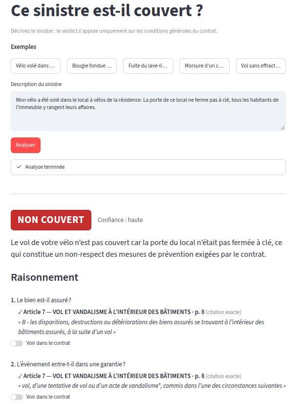
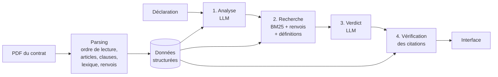

# Sinistre & Conditions Générales

**Un sinistre est-il couvert par le contrat ? Pourquoi, et sur quelles clauses ?**

Cet outil lit les Conditions Générales d'un contrat d'assurance habitation et répond à une
déclaration de sinistre par un verdict justifié : chaque affirmation est appuyée par une
citation du contrat, vérifiée mot pour mot. Quand le contrat ne permet pas de trancher, il le
dit : « ça dépend de telle option » ou « je ne sais pas, voici ce qu'il faut demander ».

🔗 **Démo en ligne : https://sinistre-cg.streamlit.app**

 <!-- TODO : ajouter une capture du cas du vélo -->

---

## En bref

| | |
|---|---|
| **Contrat de test** | Conditions Générales Multirisque Habitation, Mutuelle de Poitiers (72 pages, document public) |
| **Verdicts** | `couvert` · `non couvert` · `dépend` (d'une option ou d'un fait) · `incertain` |
| **Justification** | citations mot pour mot, avec article et page, surlignées dans le PDF |
| **Résultats** | 18 verdicts corrects sur 20 · 93 % de citations vérifiées · aucun « couvert » à tort |
| **Coût** | environ 15 % du contrat envoyé au LLM par sinistre |

---

## Exemple

> *« On m'a volé mon vélo dans le local à vélos commun de l'immeuble, qui n'était pas fermé à clé. »*

**Verdict : non couvert en garantie de base, peut l'être avec une option.**

1. La garantie vol exclut les objets déposés « dans des locaux à usage collectif »
   — *Article 7, p. 9* ✓
2. Le contrat définit l'effraction comme le forcement d'un local « dont toutes les issues sont
   verrouillées » : un local ouvert n'en relève pas — *Lexique, p. 56* ✓
3. Seule la clause optionnelle **L03** (matériel de sport en tous lieux) couvre le vol de vélo
   hors domicile, si le vélo était attaché par un antivol — *Clause L03, p. 65* ✓

**À demander à l'assuré :** la clause L03 figure-t-elle aux Conditions particulières ? Le vélo
était-il attaché ? Une plainte a-t-elle été déposée ?

---

## Pourquoi pas « le PDF dans un chatbot »

Trois constats faits sur ce contrat :

1. **L'ordre du texte extrait est faux.** Une extraction naïve sort les titres d'articles en
   bas de page, après leur contenu. Découper sur « Article N » donne alors des morceaux faux.
2. **Une réponse mobilise des articles éloignés.** Le cas du vélo se joue entre l'article 7,
   son exclusion, une définition du lexique (article 69) et une clause optionnelle de
   l'article 70, soit 60 pages d'écart.
3. **Le contrat redéfinit les mots courants.** « Effraction », « dépendance », « incendie »
   n'y ont pas leur sens habituel, et c'est souvent la définition qui tranche.

Un LLM qui lit tout le PDF peut répondre juste sur un contrat, mais il ne cite pas ses sources
de façon vérifiable et ne passe pas à l'échelle de centaines de contrats.

---

## Comment ça marche



**Préparation du contrat (une seule fois).** Le PDF est lu avec les coordonnées de chaque ligne
pour reconstituer l'ordre de lecture. Il est découpé en 76 articles et 52 clauses optionnelles,
chacun séparé en sous-parties typées (garantie, exclusion, prévention, condition). Le lexique
(83 définitions) et les renvois internes (« voir art. 34 », « clause L03 ») sont extraits.

**1. Analyse.** Le LLM lit la déclaration et une « carte » du contrat (une ligne par article),
en extrait les faits et choisit les articles candidats. Cette étape rattrape les écarts de
vocabulaire : « mon chien a mordu un passant » ne contient aucun mot de l'article sur la
responsabilité civile.

**2. Recherche.** Une recherche plein texte (BM25, en français) complète ce choix. Le système
ajoute automatiquement les articles cités en renvoi, les définitions utiles, les exclusions
communes (art. 41) et l'étendue territoriale (art. 40).

**3. Verdict.** Le LLM raisonne uniquement sur ces passages, dans l'ordre d'un gestionnaire :
le bien est-il assuré ? l'événement est-il garanti ? les conditions sont-elles remplies ? une
exclusion s'applique-t-elle ? Il distingue garantie de base et options, et ne peut invoquer
une option que si elle figure dans les passages.

**4. Vérification.** Chaque citation est recherchée dans le texte du contrat, sans LLM. Une
citation introuvable est rejetée. Un verdict ferme sans aucune citation valide devient
« incertain ». Les citations valides sont localisées dans le PDF pour être surlignées.

---

## Résultats

Évaluation sur **20 sinistres** couvrant tout le contrat : dégâts des eaux, tempête,
cambriolage avec et sans effraction, bris de glace, foudre, inondation avec et sans arrêté de
catastrophe naturelle, responsabilité civile, vol à l'étranger, termites, options non
souscrites, déclaration trop vague. Chaque cas a été vérifié à la main contre le texte du
contrat (`eval/cases.json`).

**Recherche** : part des articles nécessaires présents dans le contexte envoyé au LLM.

| Configuration | Rappel | Cas complets | Contexte moyen |
|---|---|---|---|
| Recherche seule (BM25 + renvois + lexique) | 79,8 % | 14 / 19 | 14 % du contrat |
| + analyse par le LLM | **95,6 %** | 17 / 19 | 15 % du contrat |

**Verdicts**

| Mesure | Résultat |
|---|---|
| Verdicts corrects | **18 / 20** |
| Cas non couverts déclarés « couverts » | **0** |
| Citations vérifiées dans le contrat | **93 %** |

Les deux erreurs restantes vont dans le sens de la prudence : un cambriolage avec effraction
jugé « incertain » au lieu de « couvert », et une tache d'humidité de cause inconnue jugée
« incertain » au lieu de « dépend ». Le système ne déclare jamais couvert un sinistre qui ne
l'est pas.

<!-- TODO : ajouter le résultat sur les 5 cas jamais vus pendant le développement -->

### Ce que l'évaluation a appris

- **L'analyse par le LLM fait gagner 16 points de rappel** : c'est elle qui relie le
  vocabulaire de l'assuré à celui du contrat.
- **Le modèle a inventé une « option anti-termites »** qui n'existe pas dans le contrat. La
  règle « une option n'est invoquée que si elle figure dans les passages » l'a corrigé.
- **Le modèle hésitait trop** : il répondait « dépend » dès qu'une clause restrictive existait.
  La règle « une clause dont on ignore la souscription et qui restreint la garantie ne change
  pas le verdict » a fait passer le score de 13 à 18 sur 20.
- **7 % des citations sont rejetées** : paraphrases, morceaux recollés, et une phrase inventée.
  La vérification les écarte du raisonnement.

---

## Passer à des centaines de contrats

Ce prototype traite un contrat à la fois. Pour un portefeuille réel :

- **Extraction structurée vers une table.** Une ligne par garantie et par contrat : événement,
  biens, conditions, exclusions, plafond, article source. La question « quels contrats couvrent
  le vol hors domicile sans option ? » devient une requête SQL, et le LLM ne relit que les
  articles des lignes retenues.
- **Parsing par famille de documents.** Les règles de mise en page (marges, polices des titres,
  lexique) varient d'un assureur à l'autre : un profil par famille, ou un parseur de mise en
  page en amont.
- **Conditions particulières.** C'est là que figurent les options réellement souscrites. Les
  relier au contrat transformerait la plupart des « dépend » en verdict ferme.
- **Coût maîtrisé.** Le contexte envoyé au LLM ne dépend pas de la taille du contrat : environ
  3 500 tokens pour l'analyse et 13 600 pour le verdict. Les réponses sont mises en cache.

---

## Limites

- Le parsing est calé sur la mise en page de ce contrat.
- Les Conditions particulières ne sont pas traitées : on peut cocher les options souscrites
  dans l'interface, mais elles ne sont pas lues automatiquement.
- Le jeu de test (20 cas) a servi à ajuster les prompts : le score sur des cas nouveaux peut
  être plus bas.
- L'outil aide un gestionnaire à instruire un dossier, il ne remplace pas sa décision.

---

## Installation

```bash
git clone https://github.com/rabieessayeh/sinistre-cg.git
cd sinistre-cg
python -m venv .venv && source .venv/bin/activate
pip install -r requirements.txt
cp .env.example .env    # puis renseigner les clés
```

Le LLM passe par n'importe quelle API compatible OpenAI (Groq, Mistral, Gemini, Ollama en
local…). L'analyse et le verdict peuvent utiliser deux fournisseurs différents :

```
LLM_BASE_URL=...            LLM_VERDICT_BASE_URL=...   # optionnel
LLM_API_KEY=...             LLM_VERDICT_API_KEY=...
LLM_MODEL=...               LLM_VERDICT_MODEL=...
```

## Utilisation

<!-- TODO : vérifier les noms des commandes après l'optimisation -->

```bash
streamlit run app.py                                   # interface

python -m sinistre_cg verdict "Mon lave-linge a fui et abîmé le parquet."
python -m sinistre_cg verdict "..." --options art33 clL03   # options souscrites connues
python -m sinistre_cg retrieve "..." --llm             # passages retrouvés seulement
```

Préparer un nouveau contrat :

```bash
python -m sinistre_cg parse data/raw/<contrat>.pdf     # extraction, découpage, enrichissement
python -m sinistre_cg map                              # carte du contrat (LLM)
```

## Évaluation

```bash
python eval/run_eval.py                    # rappel de la recherche, sans LLM
python eval/run_eval.py --llm              # avec l'analyse
python eval/run_eval.py --mode full        # verdicts complets
python eval/run_eval.py --reverify         # revérifie les citations, sans LLM
pytest
```

## Structure

```
sinistre_cg/    extraction, découpage, enrichissement, recherche, verdict, citations, LLM
app.py          interface Streamlit
eval/           jeu de test (cases.json), évaluation, résultats de référence
tests/          tests unitaires
data/raw/       contrat PDF
data/processed/ données structurées (articles, clauses, lexique, carte)
```

---

*Contrat utilisé : Conditions Générales Multirisque Habitation de la Mutuelle de Poitiers
Assurances, document public, utilisé uniquement à des fins de démonstration. Aucune donnée
d'assuré réel n'est traitée.*

Rabie Es-Sayeh · [Portfolio](https://rabieessayeh.github.io/profile)
